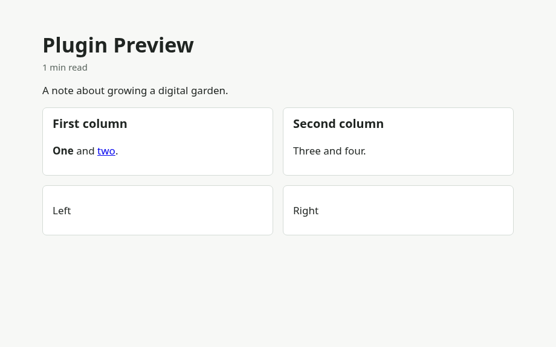

# Horizontal Blocks for Digital Garden

Publish side-by-side Markdown columns from Obsidian's Horizontal Blocks fences. Columns share the available width and stack on narrow screens. Published notes with a visible title also get a reading-time estimate based on 200 words per minute, rounded up with a one-minute minimum.



## Install on Forestry.md

In Obsidian, open **Settings → Digital Garden → Plugins → Manage plugins → Browse & install**. Under **Install from GitHub**, paste the public URL for this plugin, click **Check plugin**, and confirm. Forestry rebuilds the site after installation.

To host this plugin yourself, publish the extracted files in a public GitHub repository with `garden-plugin.json` at the repository root. Use the URL of that repository in the plugin manager.

## Install manually on a self-managed garden

Copy the entire `horizontal-blocks` directory into `src/plugins/` of a plugin-enabled [Digital Garden template](https://github.com/oleeskild/digitalgarden), so the manifest is at `src/plugins/horizontal-blocks/garden-plugin.json`. Rebuild the garden. No extra packages are needed.

## Write columns

~~~markdown
```horizontal
### First column

Write Markdown here.
---

### Second column

Add an image, link, or list here.
```
~~~

Use either `horizontal` or `hblock`. Put each separator on its own unindented line. For a horizontal rule inside a column, use `***`. The published columns have equal widths and the page does not include Obsidian's editor controls or saved column widths.

## Obsidian images in columns

Use `![[image.png]]` or `![[Attachments/image.png]]` for an image already published to the garden. If multiple published images have the same filename, use the full vault-relative path. Standard Markdown image syntax works with public URLs too.

Digital Garden's Obsidian publisher skips attachment discovery inside fenced blocks. To upload a local image to Forestry, include its embed in the regular body of a published note outside any code fence. Then publish or republish that note. Keep the embed there so the attachment remains part of the published garden.

## Reading time

The label counts rendered words and skips fenced code. To hide it for a note, set `dgReadingTime: false` in that published note's frontmatter.
